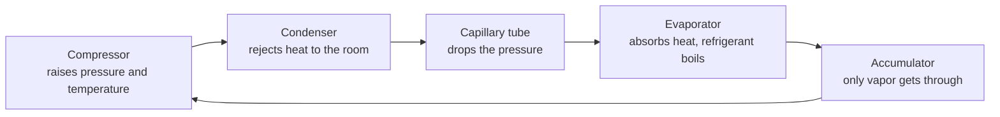
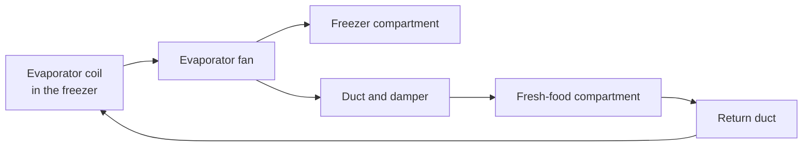

# Phase 1: Understanding the Refrigeration Cycle

Before I opened anything, I needed a mental model of what a fridge is actually doing. Without one, every symptom is just "it's warm" and every part is just "a thing that could be broken." With one, the symptoms start narrowing the search on their own.

This page is the mental model I built for my **Samsung RT32FARADWW**, a single-evaporator, top-mount, inverter refrigerator. It's the one I kept coming back to during the whole diagnosis.

---

## 1. The big idea: a fridge moves heat, it doesn't make cold

A fridge doesn't create cold. It **picks up heat inside the cabinet and dumps it into the room**. That's why the back and sides of a running fridge feel warm.

It does this by circulating a refrigerant through a sealed loop. The trick is that a liquid absorbs a lot of heat when it boils, and the boiling point of the refrigerant depends on its pressure:

- **Lower the pressure** and it boils at a very low temperature, cold enough to pull heat out of a freezer.
- **Raise the pressure** and it condenses back into a liquid at a temperature above room temperature, hot enough to shed that heat into the kitchen.

So the whole cycle boils down to this: *control the pressure to control where the refrigerant boils and where it condenses.*

---

## 2. The four stages

| Stage | What happens | What the refrigerant is doing | How you'd notice it |
|---|---|---|---|
| **Compressor** | Squeezes low-pressure vapor into hot, high-pressure vapor | Pressure and temperature go up | The hum and warm body at the back of the fridge |
| **Condenser** | Hot vapor gives up heat to the room air and turns into liquid | Vapor to liquid, heat leaves the system | The warm coil at the back or bottom |
| **Capillary tube** (with a filter drier) | A long, very thin tube restricts the flow, so pressure falls sharply | Liquid becomes low-pressure and cold | Nothing visible. A blockage here would starve the evaporator |
| **Evaporator** | The liquid boils, absorbing heat from the air passing over the coil | Liquid to vapor, heat enters the system | The frosty coil inside the freezer |
| **Accumulator** | Traps any leftover liquid so only vapor returns to the compressor | Vapor | A small canister on the return pipe |

**Why the accumulator exists:** compressors are built to squeeze gas. A liquid is basically incompressible, so liquid refrigerant reaching the compressor can seriously damage it. The accumulator is cheap insurance.

Many modern domestic fridges use isobutane (R600a) as the refrigerant. The data label on your unit tells you which one yours uses. Either way, this is a **sealed** circuit that you don't open at home.

---

## 3. Why summer made everything worse (but wasn't the cause)

The condenser can only dump heat into air that is cooler than the hot refrigerant. In a hot kitchen that gap shrinks, so heat leaves more slowly, the compressor runs longer, and the whole system works harder. Unstable mains voltage adds electrical stress on top of that.

Those are real strain factors, but they are **stress factors, not diagnoses**. A fridge compartment sitting at room temperature while the compressor is running normally can't be explained by "it's hot outside." That mismatch is what told me to look elsewhere.

---

## 4. The inverter compressor and the two boards

Older fridges have a compressor that is simply on or off. Mine has an **inverter compressor** that can run at variable speeds. It runs fast when it needs to pull temperature down, and slow when it only needs to maintain it. That's quieter and more efficient.

Making that work takes two boards:

| Board | Role | LED on my unit |
|---|---|---|
| **Power PCB** (main board) | The brain. Reads the temperature sensors, runs the fans, defrost heater and relays, decides how fast the compressor should go, and reports faults | Blinks a fault code |
| **IPM PCB** (inverter board) | Takes the target speed and drives the compressor's three motor windings through the U, V and W wires, using an Intelligent Power Module (IPM) | Steady when the compressor is being driven; blinks its own codes for inverter faults |

The two boards talk to each other through connecting cables. If that communication breaks, both boards stop and the fridge is dead.

**Why this matters for diagnosis:** a problem in the brain can leave the compressor side completely healthy, and the two LEDs help separate the two. In my case the IPM LED was steady (compressor drive fine) while the power PCB blinked (brain complaining).

---

## 5. Airflow in a single-evaporator top-mount fridge

This is the part that turned out to be central to my whole troubleshooting logic.

In a single-evaporator design like the Samsung RT32 series, **there is only one evaporator coil, and it lives in the freezer**. Cold air is pushed down into the fresh-food section by an **evaporator fan** through ductwork. A damper controls how much cold air the fresh-food section receives.

Compare that with dual-evaporator systems, which have a dedicated cooling coil for each compartment. Those compartments cool independently. In my fridge, **the lower compartment is entirely dependent on clear air passages from the freezer above it.** If air can't flow, the fresh-food section has no other source of cold.

---

## 6. Frost, and why every frost-free fridge needs a defrost system

Every time the door opens, humid room air gets in. That moisture condenses and freezes on the coldest surface it touches: the evaporator coil. Left alone, frost builds up on the fins, insulates the coil, and clogs the gaps that air needs to pass through.

So "frost-free" fridges don't prevent frost. They **melt it regularly and send the water down a drain.**

### Older units: the mechanical defrost timer

Legacy, non-inverter fridges use a small motorized timer. It turns while the compressor runs, and every 6 to 12 hours a cam trips a switch that cuts power to the compressor and sends line voltage to the defrost heater. Technicians can test one by turning the timer's screw by hand until it clicks into defrost mode.

### Newer units like mine: electronic, sensor-driven defrost

The main board runs the show:

1. **Cooling mode.** The main board reads the air thermistors and tells the inverter board to drive the compressor. The evaporator fan pushes chilled air from the freezer coil down the ductwork.
2. **Defrost initiation.** Based on compressor run time and door openings, the board pauses the compressor and fan. It then closes a relay that sends line voltage through the **thermal fuse** and the **closed bimetal thermostat** to the **defrost heater**.
3. **Normal termination.** The **evaporator NTC thermistor** watches the coil temperature. When the frost has melted and the coil reaches roughly 8 to 10 °C, the board opens the relay and the heating stops.
4. **Safety backup 1: bimetal thermostat.** If the NTC drifts or fails, the bimetal snaps open mechanically at around 10 to 15 °C and cuts power to the heater directly.
5. **Safety backup 2: thermal fuse.** If the relay welds shut, the non-resetting fuse blows permanently at around 72 °C, preventing thermal runaway and damage to the cabinet.

### The defrost chain at a glance

| Part | Job | Healthy reading |
|---|---|---|
| **Defrost relay** (on the main board) | Switches mains power to the heater during defrost | Closes only during defrost |
| **Thermal fuse** | One-shot, last-resort protection | Continuity, about 0 Ω |
| **Bimetal thermostat** | Mechanical backup that opens when the coil gets warm | Open (∞ Ω) at room temperature, closed (about 0 Ω) when frozen |
| **Defrost heater** | Melts the frost off the fins | About 200 to 400 Ω |
| **Evaporator NTC** | Tells the board when the frost is gone | About 5 kΩ at 25 °C, about 13 kΩ at 0 °C |

**Why three layers of control?** Each layer protects against a different failure. The NTC handles normal operation. The bimetal covers the case where the NTC lies. The fuse covers the case where the relay is stuck and everything else has failed. Knowing that also tells you what a blown fuse means: something let the heater run too long, so you don't just replace the fuse, you go and inspect the relay too.

---

## 7. How a defrost fault ends with a warm fridge

Here is the chain of events, and it's the reason a fridge at room temperature sent me to the freezer:

1. Something in the defrost circuit stops the heater from working. It could be an open heater, a blown thermal fuse, a drifted NTC sensor, a failed relay, or a control board that isn't driving the relay at all.
2. Frost isn't melted between cooling cycles, so it accumulates on the evaporator.
3. The frost chokes the fins and blocks the return duct.
4. Less air passes over the cold coil, and the air that does pass is poorly cooled, so the freezer struggles at degraded performance.
5. The fresh-food compartment depends entirely on air pushed down the duct. With that airflow blocked, it warms up to room temperature.

That is exactly the picture I had. So when diagnosing this fault the order is:

1. Verify the 5-blink defrost error on the main board.
2. Test the continuity and resistance of every part in the heater loop.
3. Confirm the bimetal thermostat and thermal fuse are intact.
4. Only then consider replacing the main control board.

---

## 8. From symptom to suspect

This table is the quick version of the mental model. It tells you where to look first.

| What you see | Most likely area |
|---|---|
| Both compartments warm, compressor silent | Power to the compressor: inverter (IPM) board, main board, compressor protection parts |
| Both warm, compressor running, nothing gets cold | The sealed refrigerant system (leak or blockage), which needs special equipment to diagnose |
| Freezer cold, fridge warm | Airflow: fan, damper, blocked duct, frost buildup |
| Freezer weak **and** fridge warm | A frost-choked evaporator, meaning a defrost failure (my situation) |

---

## Takeaways from this phase

- A fridge moves heat. Anything that blocks the movement of heat or air will look like "it's not cooling."
- In a single-evaporator fridge, the fresh-food section is a downstream customer of the freezer. Freezer-side problems show up in the fridge first.
- My compressor ran normally, which meant the refrigerant loop was doing its job. The failure had to be in the systems that support it.
- Defrost is a chain (relay, fuse, bimetal, heater, sensor) with built-in redundancy. That makes it very testable, one link at a time.

**Next:** [Phase 2, the diagnostic walkthrough](2-diagnostic-walkthrough.md)
