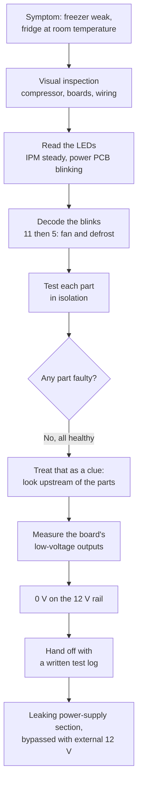

# Fixing a Frost-Free Fridge: From Blink Codes to a Dead 12 V Rail

A student-led diagnostic project on a **Samsung RT32FARADWW** top-mount inverter refrigerator. It covers the refrigeration cycle, the error codes, component-level testing, and the repair, including the fault that no single component test could have found on its own.

> **The short version:** every part I tested turned out to be healthy. That was the most useful result of the whole project, because it pushed me to stop suspecting the parts and start suspecting whatever powers them.

---

## The story in one minute

In the middle of a summer heatwave, with the national power grid overloaded and the voltage unstable, our fridge stopped cooling properly. It hit right in the middle of our holidays. The freezer was cold, but not cold enough to keep food frozen, and the fresh-food compartment had drifted up to room temperature.

Instead of calling a technician straight away, my dad and I did what we always do: we tried to fix it ourselves, or at least understand what had gone wrong.

1. **Visual inspection first.** The compressor was running and nothing looked burnt or damaged.
2. **Read the boards.** The inverter (IPM) board had a steady LED, meaning the compressor was being driven normally. The main (power) board's LED blinked **11 times, paused, then 5 times**: a freezer fan fault and a defrost fault.
3. **Test every part the codes pointed at.** Fan, defrost heater, thermal fuse, bimetal thermostat, NTC sensor, defrost relay. All healthy.
4. **Reframe.** If every part is fine and the system still fails, something upstream isn't feeding them.
5. **Follow the voltage.** The fridge light was also dead. It worked perfectly on a separate supply, so I measured the board's output and found **no 12 V at all**.
6. **Hand off with evidence.** I couldn't find a visibly failed part in the power stage, so I took the board to an experienced technician with my test notes. He found a micro-leakage in the board's switching power supply and bypassed that section with an external 12 V supply. The board worked again.

---

## Project at a glance

| | |
|---|---|
| **Appliance** | Samsung RT32FARADWW, single-evaporator top-mount, inverter compressor |
| **Symptoms** | Freezer weak, fresh-food compartment at room temperature |
| **Error codes** | Power PCB LED: 11 blinks, pause, 5 blinks (freezer fan + defrost) |
| **Inverter board (IPM) LED** | Steady, so the compressor drive was fine |
| **Parts tested** | Fan, defrost heater, thermal fuse, bimetal thermostat, NTC sensor, defrost relay |
| **Result of part tests** | All healthy |
| **Key measurement** | 0 V on the board's 12 V output |
| **Root cause** | Micro-leakage in the 12 V switching power supply section of the power PCB |
| **Fix** | Faulty section bypassed with an external 12 V supply |
| **Who** | Me, my dad, and a very kind, experienced repair technician |

---

## How this repo is organized

The five phases follow the order I actually worked in: understand, diagnose, decode, test, repair.

| Phase | File | What you'll find |
|---|---|---|
| 1 | [Refrigeration cycle](1-refrigeration-cycle.md) | How a fridge moves heat, why single-evaporator airflow matters, how defrost works and how a defrost fault turns into a warm fridge |
| 2 | [Diagnostic walkthrough](2-diagnostic-walkthrough.md) | My full diagnostic path, step by step, with the reasoning behind each decision |
| 3 | [Error code reference](3-error-code-reference.md) | How to read the LEDs, the blink-code table, and reference sensor values |
| 4 | [Testing equipment and methods](4-testing-equipment-and-methods.md) | The few tools that matter and how to test every component, including how to identify the pins of a 4-pin defrost relay |
| 5 | [Repair and lessons learned](5-repair-and-lessons-learned.md) | What the technician found, what he changed, and the lessons I'm keeping |

```
.
├── README.md
├── 1-refrigeration-cycle.md
├── 2-diagnostic-walkthrough.md
├── 3-error-code-reference.md
├── 4-testing-equipment-and-methods.md
└── 5-repair-and-lessons-learned.md
```

---

## The diagnostic path at a glance



---

## Using this on other models

This project is documented on one specific Samsung, but the ideas travel well. Modern frost-free fridges are all built from the same handful of building blocks:

- NTC temperature sensors
- DC fans
- A defrost heater protected by a bimetal thermostat and a thermal fuse
- Relays that switch the heavy loads
- A power supply stage that turns mains into low-voltage DC for the control board
- A main board that reads, decides, and reports faults with a blink code

Brands and generations differ in connector numbers, wire colors, and blink counts. The **mechanism** is the same. If you understand why each part exists and what it does, small differences won't stop you.

Here is how I'd adapt this repo to a different fridge:

1. **Find your model's blink table.** Check the service manual, a label inside or on the back of the unit, or the manufacturer's support page. Map each code to a subsystem: sensor, fan, defrost, compressor.
2. **Locate the boards and their LEDs.** Learn what "normal" looks like at power-up before you go hunting for faults ([Phase 3](3-error-code-reference.md) shows what I saw).
3. **Test what the code points at, in isolation**, using the procedures in [Phase 4](4-testing-equipment-and-methods.md). The expected values in this repo come from my unit, so confirm them against your model.
4. **Cross-check sensors against each other.** Sensors of the same type should read about the same at the same temperature.
5. **If everything passes, keep going.** Measure the low-voltage outputs of the board. That is what cracked my case.
6. **Write everything down** as you go.

The goal is never to replace a part because it's the "usual suspect." It is to test well enough to replace **only the exact part that failed**, and avoid wasting money on the rest.

---

## Quick glossary

| Term | Meaning |
|---|---|
| **PCB** | Printed circuit board, the electronics board |
| **Power PCB / main board** | The "brain": reads sensors, drives fans, heater and relays, reports fault codes |
| **IPM PCB / inverter board** | Drives the variable-speed compressor through an Intelligent Power Module (IPM) |
| **Evaporator** | The cold coil that absorbs heat from the air |
| **Condenser** | The coil that releases that heat into the room |
| **NTC thermistor** | A temperature sensor whose resistance drops as temperature rises |
| **Bimetal thermostat** | A mechanical temperature switch made of two bonded metals that bend at different rates |
| **SMPS** | Switch-mode power supply, the circuit that turns mains into a stable low-voltage DC |
| **PWM controller** | The chip inside an SMPS that switches power on and off very fast to regulate the output |
| **Optocoupler** | A part that passes a signal using light, so two circuits can talk without being electrically connected |

---

## Safety and scope

This repository is a **learning log**, not a professional repair manual. Your model's service manual always wins over anything written here.

- Unplug the fridge before opening anything. The only live measurements in this project were DC voltage checks on the board's low-voltage output connectors.
- Mains-side parts of a board can hold dangerous voltage even after unplugging.
- The refrigerant circuit is sealed and pressurized. Don't cut, puncture, or bend the tubes.

---

## Final thought

The refrigeration cycle itself was never broken. The compressor ran, the loop did its job, and the "brain" that supports it was starving for power. Sometimes the most valuable diagnostic step is realizing that the thing that looks broken and the thing that is broken aren't the same.
